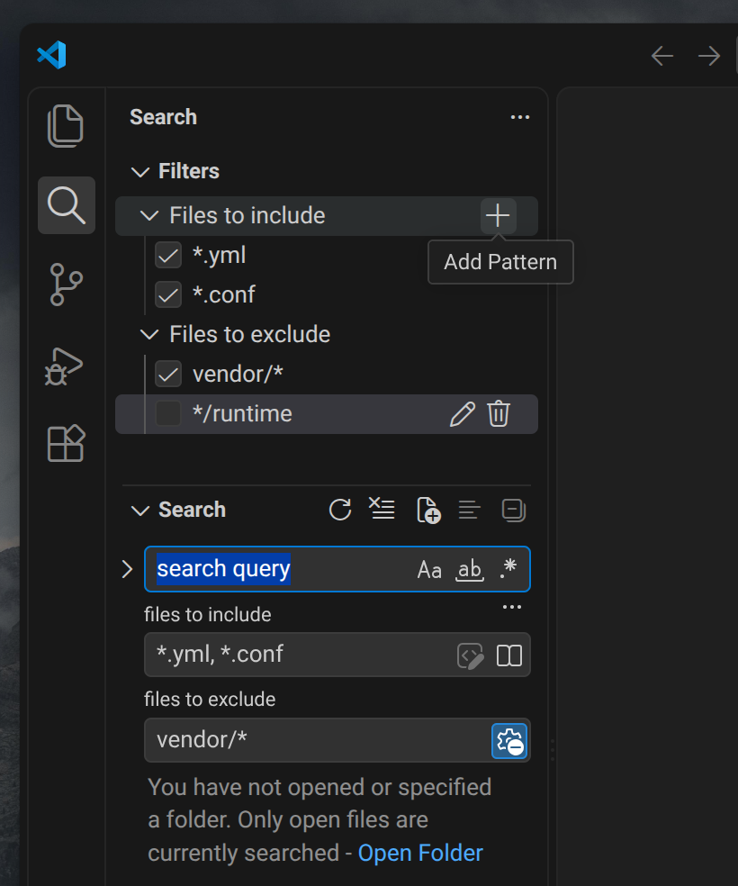

# Search Filters

A handy interface for switching frequently used search patterns.

Typing the same globs into the Search panel's **files to include** and **files to exclude** fields again and again gets old fast. Search Filters keeps your patterns in two lists right inside the Search panel. Tick a checkbox and the search re-runs with the new filters.

## Features

The extension adds a **Filters** view to the Search panel with two lists:




```
FILTERS
├─ Files to include                    (+)
│   ├─ ☑ src/**                (✎) (🗑)
│   └─ ☐ **/*.test.ts           (✎) (🗑)
└─ Files to exclude                    (+)
    ├─ ☑ **/vendor/**          (✎) (🗑)
    └─ ☑ **/cache/**           (✎) (🗑)
```

- **Add** a pattern with the `+` button on a list header.
- **Edit** a pattern or **remove** it with the buttons on its row. Editing keeps the pattern's position and checkbox state.
- **Toggle** a pattern with its checkbox to turn it on or off without deleting it.
- **Search updates on its own.** Every change runs the search again. The enabled patterns of each list are joined with `, ` and placed in the matching Search field. A list with nothing enabled clears its field.

Row buttons appear when you hover over a row, as in other VS Code tree views.

> The Filters view is moved into the Search panel when the extension is first activated. After that you can drag it anywhere, and VS Code remembers where you put it.

## Extension Settings

Patterns are stored in **workspace settings**, so each project has its own lists. They live in `.vscode/settings.json`, or in the `settings` section of your `*.code-workspace` file. If no folder is open, they go to user settings.

| Setting | Description |
|---|---|
| `searchFilters.include` | Patterns for *files to include*: `{ "<glob>": <enabled> }` |
| `searchFilters.exclude` | Patterns for *files to exclude*: `{ "<glob>": <enabled> }` |

The format is the same as the built-in `files.exclude`, and you can edit it by hand. The view picks up changes right away:

```jsonc
{
  "searchFilters.include": {
    "src/**": true,
    "**/*.test.ts": false
  },
  "searchFilters.exclude": {
    "**/vendor/**": true,
    "**/cache/**": true
  }
}
```

## Known Issues

- Extensions can't read what is typed in the Search box. When the filters are applied, VS Code may replace the search text with the current editor selection, depending on `editor.find.seedSearchStringFromSelection`.
- Extensions can't put a view straight into the Search panel. Filters is declared in the Explorer and moved with the internal `vscode.moveViews` command. If a future VS Code release changes that command, drag the view to the Search panel by hand.

## License

[MIT](LICENSE)
